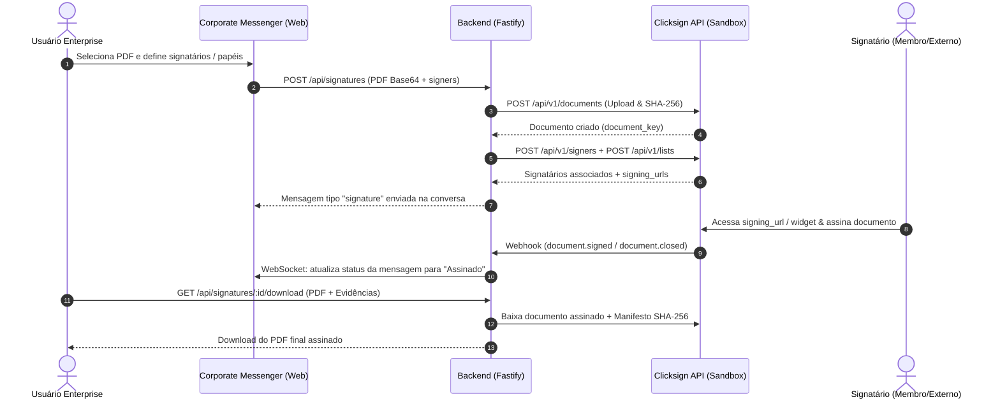

# Spike Técnico: Provedor de Assinatura Eletrônica (T-31)

## 1. Contexto e Enquadramento Legal

O plano **Enterprise** do Corporate Messenger disponibiliza o envio de documentos para assinatura eletrônica integrada ao chat corporativo.

No Brasil, a validade jurídica de assinaturas eletrônicas é regida pela **Medida Provisória nº 2.200-2/2001** e pela **Lei Federal nº 14.063/2020**, que classifica as assinaturas em três modalidades:

1. **Assinatura Eletrônica Simples:**
   - Permite identificar o signatário e anexa dados eletrônicos a outros dados (ex.: confirmação por e-mail, aceite via token, geolocalização e IP).
   - Ideal para aprovações internas, termos corporativos, recibos e ordens de serviço.
2. **Assinatura Eletrônica Avançada:**
   - Associada ao signatário de forma unívoca, utiliza dados sob seu controle exclusivo (ex.: autenticação multifator via SMS/WhatsApp, validação de CPF/dados na Receita, Pix de validação de titularidade ou biometria/selfie).
   - Garante a integridade do documento por meio de hash criptográfico (**SHA-256**) e certificado de evidências.
   - Validade para contratos comerciais, acordos de confidencialidade (NDA), propostas e aditivos contratuais.
3. **Assinatura Eletrônica Qualificada:**
   - Utiliza certificado digital ICP-Brasil (A1/A3).

**Escopo do MVP Enterprise:** Foco nas assinaturas **Simples e Avançadas** com trilha de auditoria completa e hash SHA-256, com suporte a signatários externos e internos.

---

## 2. Comparativo de Provedores Avaliados

| Critério                      | Clicksign                                                                            | D4Sign                             | DocuSign                     |
| :---------------------------- | :----------------------------------------------------------------------------------- | :--------------------------------- | :--------------------------- |
| **Foco Geográfico / Legal**   | Brasil (Lei 14.063 / MP 2.200-2)                                                     | Brasil (Lei 14.063 / MP 2.200-2)   | Global (eIDAS / ESIGN)       |
| **API REST & DX**             | API v1 / v3 madura, documentação clara e SDKs                                        | API REST completa                  | API extensa e complexa       |
| **Ambiente de Sandbox**       | Sandbox ilimitado com simulação de assinatura                                        | Sandbox dedicado                   | Sandbox developer            |
| **Métodos de Autenticação**   | E-mail, SMS, WhatsApp, Pix, Selfie/Doc, ICP-Brasil                                   | E-mail, SMS, WhatsApp, Pix, Selfie | E-mail, SMS, ID Verification |
| **Certificado de Evidências** | Manifesto de Evidências em PDF/JSON com SHA-256, IPs, User-Agents e carimbo do tempo | Trilha em anexo / Log              | Certificate of Completion    |
| **Webhooks & Segurança**      | HMAC SHA-256, retentativas e logs detalhados                                         | Webhooks REST                      | Webhooks Connect             |
| **Preço & Moeda**             | R$ por envelope / pacote SaaS                                                        | R$ por envelope / documento        | Cobrança em USD              |

---

## 3. Decisão Arquitetural (ADR)

**Decisão:** **Clicksign** foi selecionada como provedora oficial da funcionalidade de Assinatura Eletrônica do Corporate Messenger.

### Justificativas:

1. **API REST e Sandbox Realista:** A Clicksign oferece endpoints consistentes para criação de documentos, signatários e listas de assinaturas (`POST /documents`, `POST /signers`, `POST /lists`), permitindo execução e simulação ponta a ponta em sandbox sem custos adicionais.
2. **Conformidade de Evidências (SHA-256):** Gera o hash SHA-256 do documento original e do documento final assinado, juntamente com registro de IP, data/hora no fuso horário brasileiro (UTC-3), método de autenticação e identificação unívoca.
3. **Webhooks Confiáveis:** Notificações em tempo real com validação HMAC para atualização instantânea das mensagens no chat.
4. **Política de Retenção de Dados:** Documentos assinados e certificados de evidências podem ser baixados pelo backend e expurgados conforme a política de retenção temporária do sistema (5 dias), respeitando a LGPD.

---

## 4. Arquitetura do Fluxo no Corporate Messenger

---

## 5. Critérios de Aceite do Spike (T-31)

- [x] Seleção fundamentada entre Clicksign e D4Sign.
- [x] Serviço de integração `ClicksignService` com suporte a Sandbox e Produção.
- [x] Teste ponta a ponta no Sandbox: criação de documento, registro de signatários, simulação de assinatura, geração de hash SHA-256, emissão de manifesto de evidências e download de documento assinado.
- [x] Verificação de segurança de Webhooks via HMAC-SHA256.
